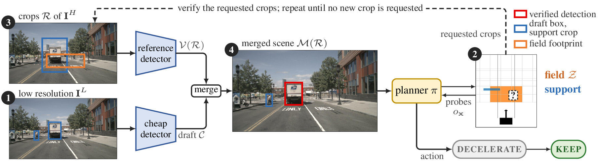

<div align="center">

# Decision-Guided Speculative Perception (DGSP)

**Check Your Blind Spots: Decision-Guided Perception by Probing the Planner with Hypothetical Objects**

[](https://arxiv.org/abs/2611.23030)
[](requirements.txt)
[](requirements.txt)
[](LICENSE)


</div>

DGSP decides where to spend high-resolution computation by asking the **planner**, not the image.
A cheap low-resolution pass gives a draft scene and action. Probing the planner with *hypothetical objects* yields a **decision-sensitivity field**, the places where an unseen object would change the action. Only this field and the **support**, the detections the action rests on, are verified at high resolution, until the action is stable.

## Method

<p align="center"></p>

## Requirements

Python 3.12 with CUDA 12.4 (the environment the numbers were produced with):

```bash
pip install -r requirements.txt
```

Datasets (nuScenes, Argoverse 2, Argoverse-HD; test splits only): see [`data/README.md`](data/README.md).

```bash
bash data/download.sh all /path/to/data      # nuScenes and Argoverse-HD need manual downloads first
python -m data.prepare --data /path/to/data  # checks that every test unit is in place
```

## Pre-trained models

```bash
bash weights/download.sh                     # fetches every file and checks its md5
```

YOLOv8s comes from the official Ultralytics COCO release. The DGSP lift (looming estimate, range refiner) and the learned
baselines (AdaScale, BAR, Chanakya) are assets of [release v1.0](https://github.com/kongwoang/DGSP/releases/tag/v1.0);
see [`weights/README.md`](weights/README.md).

## Training

DGSP itself has nothing to train: it probes the planner at run time. The released weights above cover the lift and the
learned baselines; their training scripts are not part of this release.

## Evaluation

```bash
python -m eval.run --dataset nuscenes --methods DGSP,u512,u960 --data /path/to/data
python -m eval.tables --runs runs --out tables
```

`eval.run` writes one record per frame and method to `runs/<dataset>/<setting>/<method>.pkl`; `--dataset` is one of
`nuscenes`, `av2`, `argoverse_hd`, and `--methods all` runs every row of the paper
([`baselines/README.md`](baselines/README.md) covers the baselines). `eval.tables` writes the paper's tables as CSV
(`main.csv`, `recovery.csv`, `regime.csv`, `stress.csv`, `planners.csv`) with paired unit-bootstrap intervals.

## Results

Agreement with the action of whole-frame inference at 960 px (Agr., %), braking-episode F1 (%), and detector-input
pixels (px, % of native):

| Method | nuScenes<br>Agr. / F1 / px | Argoverse 2<br>Agr. / F1 / px | Argoverse-HD<br>Agr. / F1 / px |
|:--|:-:|:-:|:-:|
| Whole frame, 512 px | 97.7 / 62.2 / 10.2 | 96.4 / 71.3 / 6.7 | 94.5 / 39.8 / 7.1 |
| Whole frame, 960 px | 100 / 65.0 / 38.4 | 100 / 75.9 / 23.2 | 100 / 40.9 / 25.3 |
| **DGSP** | **98.7 / 69.0 / 8.4** | **98.2 / 77.5 / 5.9** | **97.5 / 46.7 / 6.9** |

To reproduce the table, run on all three datasets and read the `Agr.`, `F1` and `px` rows of `tables/main.csv`:

```bash
for ds in nuscenes av2 argoverse_hd; do
  python -m eval.run --dataset $ds --methods DGSP,u512,u960 --data /path/to/data
done
python -m eval.tables --runs runs --out tables
```

## Citation

```bibtex
@misc{phamcong2026dgsp,
  title  = {Check Your Blind Spots: Decision-Guided Perception by Probing the Planner with Hypothetical Objects},
  author = {Hoang Pham Cong and Long D. Nguyen and Ho Viet Duc Luong and Nguyen Tran Minh Nhat and Binh P. Nguyen},
  year   = {2026},
  eprint = {2611.23030},
  archivePrefix = {arXiv},
  primaryClass = {cs.CV},
  url = {https://arxiv.org/abs/2611.23030}
}
```

## License and contributing

[MIT](LICENSE). Detection uses [Ultralytics YOLOv8](https://github.com/ultralytics/ultralytics) (AGPL-3.0) as a dependency.
Bug reports and pull requests are welcome through GitHub issues.
