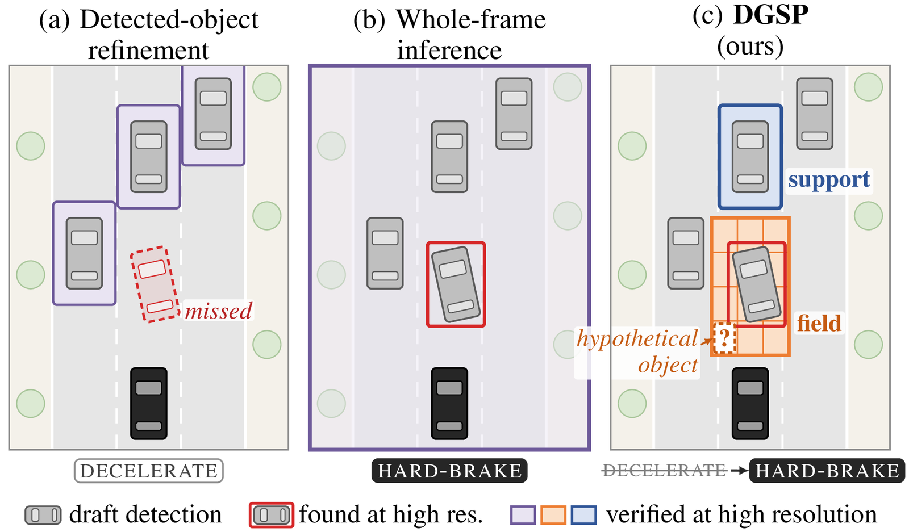

<div align="center">

# Check Your Blind Spots

### Decision-Guided Perception by Probing the Planner with Hypothetical Objects

**Hoang Pham Cong**<sup>1</sup> · **Long D. Nguyen**<sup>2</sup> · **Ho Viet Duc Luong**<sup>1</sup> · **Nguyen Tran Minh Nhat**<sup>1</sup> · **Binh P. Nguyen**<sup>2</sup>

<sup>1</sup>Hanoi University of Science and Technology &emsp; <sup>2</sup>Victoria University of Wellington

[-b31b1b.svg)](#citation)
[](requirements.txt)
[](requirements.txt)
[](LICENSE)



</div>

**DGSP** (Decision-Guided Speculative Perception) decides where to spend high-resolution computation by asking the **planner**, not the image.
A cheap low-resolution pass gives a draft scene and action. Probing the planner with *hypothetical objects* yields a **decision-sensitivity field**: the places where an unseen object would change the action. Only this field and the **support**, the detections the action rests on, are verified at high resolution, until the action is stable.

## Highlights

- **Planner-guided, detection-free selection.** The field marks where a missed object would matter, even where the draft detects nothing.
- **Provable decision exactness.** For max-composable controllers (e.g. emergency braking) and bottleneck trajectory selectors, the loop returns exactly the action of whole-frame high-resolution perception when crop detections match whole-frame ones and the crops cover the field.
- **A quarter of the pixels.** On nuScenes, Argoverse 2 and Argoverse-HD, DGSP reproduces the reference action on **97.5–98.7%** of frames with **22–27%** of its pixels, and recovers most of the decision-relevant objects that the draft misses.

## Method

<p align="center"></p>

1. **Draft.** The cheap detector runs on the frame at 320 px; the planner acts on the draft scene.
2. **Probe.** Hypothetical objects on a ground grid give the field; the support follows from the planner's thresholds or scores.
3. **Verify.** The reference detector runs only on the field footprint and the support crops (960-px scale, grid-aligned, with a truncation guard).
4. **Repeat** until no new crop is requested (at most three rounds), then act on the merged scene.

## Results

Agreement with the reference action (Agr.), braking-episode F1 against the annotations, and detector-input pixels (% of the native frame).

| Method | nuScenes<br>Agr. / F1 / px | Argoverse 2<br>Agr. / F1 / px | Argoverse-HD<br>Agr. / F1 / px |
|:--|:-:|:-:|:-:|
| Whole frame, 512 px | 97.7 / 62.2 / 10.2 | 96.4 / 71.3 / 6.7 | 94.5 / 39.8 / 7.1 |
| Whole frame, 960 px (reference) | 100 / 65.0 / 38.4 | 100 / 75.9 / 23.2 | 100 / 40.9 / 25.3 |
| **DGSP** | **98.7 / 69.0 / 8.4** | **98.2 / 77.5 / 5.9** | **97.5 / 46.7 / 6.9** |

## Getting started

### Install

```bash
git clone https://github.com/kongwoang/DGSP.git && cd DGSP
python3.12 -m venv .venv && source .venv/bin/activate
pip install -r requirements.txt
bash weights/download.sh              # YOLOv8s + DGSP weights (release v1.0), md5-checked
bash baselines/fetch_third_party.sh   # official FOVEA, UFP and BAR code (baselines only)
```

### Data

nuScenes, Argoverse 2 and Argoverse-HD require registration; see [`data/README.md`](data/README.md).

```bash
bash data/download.sh
python -m data.prepare --data /path/to/data
```

### Run

```bash
# one dataset, DGSP and the reference (u960 is required: it defines the agreement)
python -m eval.run --dataset nuscenes --methods DGSP,u960 --data /path/to/data

# every row of the paper, all datasets, then the tables
for d in nuscenes av2 argoverse_hd; do python -m eval.run --dataset $d --methods all --data /path/to/data; done
python -m eval.tables --runs runs --out tables
```

`--units N` runs the first N scenes only, a quick check. Records go to `runs/<dataset>/<setting>/<method>.pkl`, tables to `tables/*.csv`.

### Property tests

```bash
pytest -q tests/test_properties.py    # the guarantee on 100,200 random scenes, CPU, < 1 min
```

<details>
<summary><b>Paper tables and repository layout</b></summary>

| Paper | Methods | Output |
|:--|:--|:--|
| Tables 1–2, Figure 3 | u320, u320+, u512 … u1280, native, DGSP, DGSP-fast, baselines | `tables/main.csv` |
| Table 3 | DGSP, u512, u640, u960 | `tables/regime.csv` |
| Table 4 | DGSP, support only, field only, pivots, single round, w/o guard | `tables/main.csv` |
| Figure 5 | u320+ … native, AnA, Counterfactual, support only, DGSP | `tables/recovery.csv` |
| Table 5 (curved path) | DGSP, DGSP (curved loop), u512, u960 | `tables/planners.csv` |

| Path | Content |
|:--|:--|
| `dgsp/` | configuration, planners (field and support), crops and guard, the loop, the lift |
| `baselines/` | whole-frame, AdaScale, Chanakya, BAR, SAHI, FOVEA, UFP, AnA, counterfactual importance |
| `data/` | loaders, split lists, download and prepare scripts |
| `eval/` | per-frame records, metrics, tables |
| `tests/` | property tests of the guarantee |

The NAVSIM selector and the CARLA closed loop are not part of this release.

</details>

## Citation

```bibtex
@misc{phamcong2026dgsp,
  title  = {Check Your Blind Spots: Decision-Guided Perception by Probing the Planner with Hypothetical Objects},
  author = {Hoang Pham Cong and Long D. Nguyen and Ho Viet Duc Luong and Nguyen Tran Minh Nhat and Binh P. Nguyen},
  year   = {2026}
}
```

## License and acknowledgments

Code under the [MIT License](LICENSE). Detection uses [Ultralytics YOLOv8](https://github.com/ultralytics/ultralytics) (AGPL-3.0) as a pip dependency. We thank the authors of [nuScenes](https://www.nuscenes.org/), [Argoverse 2](https://www.argoverse.org/av2.html) and [Argoverse-HD](https://www.cs.cmu.edu/~mengtial/proj/streaming/) for the data, and of the baselines for their code.
